# Australia Post Retail POS — Store-Inventory-Aware Stamp Optimizer & Scale Validator

[](./src/posEngine.ts)
[](./tests/posEngine.test.ts)
[](https://shadabulhoque.vercel.app/postage-sheet.html)

> **Executive Summary:** Engineered from **4+ years of frontline retail management** at Hurlstone Park LPO (150–200 daily customer transactions). This repository documents both the **zero-latency A4 HTML counter sheet** (`counter-sheet/Postage_Quick_sheet.html`) deployed immediately at the retail counter and the **TypeScript POS optimization engine** (`src/posEngine.ts` & `src/coinWeigher.ts`) designed to align enterprise POS `'S'`-key stamp recommendations with physical Licensed Post Office (LPO) counter drawer inventory and retail profit margins.

---

## 1. Frontline Problem Statement (The `'S'` vs `'L'` POS Key Bottleneck)

During peak retail queues at an Australia Post outlet, counter staff process parcel lodgements by choosing between two franking workflows on the POS terminal:
* **`'L'` Key (Thermal Postage Label):** Prints a single zero-margin thermal barcode sticker.
* **`'S'` Key (Physical Postage Stamps):** Prompts the operator to affix physical postage stamps to the parcel.

### Why Legacy POS `'S'`-Key Logic Fails LPO Counter Operations
1. **Drawer Inventory Mismatch:** When an operator selects `'S'` for a **$10.20** parcel (Parcel Post up to 250g), the legacy POS executes a naive greedy algorithm across all theoretical denominations—recommending **`1 × $10.00` + `1 × $0.20`**. However, LPOs rarely stock `$10.00` or `$5.00` individual stamps in frontline counter drawers due to security limits and slow turnover.
2. **Retail Margin Optimization (`$1.85` Thematic Booklets):** LPOs earn a significantly higher retail commission selling through **$1.85 base/thematic stamp booklets** (*Disney, Marvel, NFL, Aussie Icons*). Frontline operators actively aim to maximize `$1.85` stamps per parcel and resolve the exact remainder using low-denomination make-up stamps (`$1.00, 50c, 25c, 20c, 10c, 5c`).
3. **Zero-Latency Queue Constraint:** In a live queue of 150–200 daily customers, alt-tabbing out of the POS terminal or typing weights into an external web calculator introduces unacceptable transaction latency.

---

## 2. System Architecture: Legacy POS Greedy vs. Store-Inventory-Aware POS Engine

```mermaid
flowchart TD
    subgraph Legacy["Legacy POS 'S' Key (Naive Greedy Algorithm)"]
        L1["Parcel Lodgement: $10.20 (Up to 250g)"] --> L2["Greedy Lookup Across All Theoretical Stamps"]
        L2 --> L3["Recommends: 1x $10.00 + 1x $0.20"]
        L3 --> L4["❌ Bottleneck: $10.00 Stamp Not in LPO Drawer\n❌ Missed $1.85 Thematic Booklet Margin\n❌ Operator Performs Mental Arithmetic Under Queue Pressure"]
    end

    subgraph Proposed["Proposed Store-Inventory-Aware POS Engine (src/posEngine.ts)"]
        P1["Parcel Lodgement: $10.20 (1020 cents)"] --> P2["Step 1: Maximize $1.85 (185c) Base/Thematic Stamps\nfloor(1020 / 185) = 5x $1.85 ($9.25)"]
        P2 --> P3["Step 2: Exact Remainder Resolution (95c)\nBounded DP over LPO Drawer Stock ($1, 50c, 25c, 20c, 10c, 5c)"]
        P3 --> P4["Recommends: 5x $1.85 + 1x 50c + 1x 25c + 1x 20c"]
        P4 --> P5["✅ 100% Drawer Stock Match\n✅ Maximizes LPO Thematic Booklet Margin\n✅ Zero Mental Math Latency at Counter"]
    end

    style Legacy fill:#1a0f0f,stroke:#ef4444,stroke-width:1.5px,color:#fca5a5
    style Proposed fill:#0f1a14,stroke:#22c55e,stroke-width:1.5px,color:#bbf7d0
```



---

## 3. Two-Tier Solution Delivery

### Tier A: Immediate Frontline Deployment (`counter-sheet/Postage_Quick_sheet.html`)
To solve the queue latency bottleneck immediately without requiring unauthorized software installation on locked-down POS terminals, I engineered an A4 printable reference sheet using HTML, Tailwind CSS, and `@media print` rules:
* **Pre-computed `$1.85` Multiplier Matrix** for all **Parcel Post** (`$10.20` – `$24.45`), **Express Post** (`$13.20` – `$32.95`), and **Domestic Letter** tiers.
* **End-of-Day Coin Bag Reference Matrix:** Prior to the POS scale software integration, staff used this side-by-side table to verify standard coin bag gram weights (`$2` = `165g`, `$1` = `180g`, `50c` = `311g`, `20c` = `565g`, `10c` = `565g`, `5c` = `283g`) during evening till reconciliation.
* **Live Preview:** [https://shadabulhoque.vercel.app/postage-sheet.html](https://shadabulhoque.vercel.app/postage-sheet.html)

### Tier B: Enterprise POS Software Engine (`src/posEngine.ts` & `src/coinWeigher.ts`)
To demonstrate how this frontline heuristic translates into enterprise POS software:
1. **[`src/posEngine.ts`](./src/posEngine.ts):** Accepts `targetInCents`, allocates maximum `$1.85` (`185c`) base/thematic stamps, and solves the exact remainder via bounded dynamic programming restricted to in-stock LPO drawer denominations.
2. **[`src/coinWeigher.ts`](./src/coinWeigher.ts):** Simulates the hardware cash-scale verification workflow across all 6 Australian coin denominations with a configurable `±3g` tolerance window and automatic missing/extra coin delta estimation.

---

## 4. Rate Tier Verification Matrix

| Service Tier | Weight Bracket | Total Rate | Legacy POS `'S'` Key | Store-Inventory-Aware POS Engine (`posEngine.ts`) |
| :--- | :--- | :--- | :--- | :--- |
| **Parcel Post** | Up to 250g | **$10.20** | `1×$10.00 + 1×20c` ❌ | **`5 × $1.85`** (`$9.25`) + **`$0.95`** (`50c + 25c + 20c`) ✅ |
| **Parcel Post** | 250g to 500g | **$11.70** | `1×$10.00 + 1×$1.00 + 1×50c + 1×20c` ❌ | **`6 × $1.85`** (`$11.10`) + **`$0.60`** (`50c + 10c`) ✅ |
| **Parcel Post** | 500g to 1kg | **$16.00** | `1×$10.00 + 1×$5.00 + 1×$1.00` ❌ | **`8 × $1.85`** (`$14.80`) + **`$1.20`** (`$1.00 + 20c`) ✅ |
| **Parcel Post** | 1kg to 3kg | **$20.25** | `2×$10.00 + 1×20c + 1×5c` ❌ | **`10 × $1.85`** (`$18.50`) + **`$1.75`** (`$1.00 + 50c + 25c`) ✅ |
| **Parcel Post** | 3kg to 5kg | **$24.45** | `2×$10.00 + 2×$2.00 + 2×20c + 1×5c` ❌ | **`13 × $1.85`** (`$24.05`) + **`$0.40`** (`2 × 20c`) ✅ |
| **Express Post** | Up to 250g | **$13.20** | `1×$10.00 + 1×$2.00 + 1×$1.00 + 1×20c` ❌ | **`7 × $1.85`** (`$12.95`) + **`$0.25`** (`25c`) ✅ |
| **Express Post** | 250g to 500g | **$15.20** | `1×$10.00 + 1×$5.00 + 1×20c` ❌ | **`8 × $1.85`** (`$14.80`) + **`$0.40`** (`2 × 20c`) ✅ |
| **Express Post** | 500g to 1kg | **$20.00** | `2×$10.00` ❌ | **`10 × $1.85`** (`$18.50`) + **`$1.50`** (`$1.00 + 50c`) ✅ |
| **Express Post** | 1kg to 3kg | **$24.75** | `2×$10.00 + 2×$2.00 + 1×50c + 1×20c + 1×5c` ❌ | **`13 × $1.85`** (`$24.05`) + **`$0.70`** (`50c + 20c`) ✅ |
| **Express Post** | 3kg to 5kg | **$32.95** | `3×$10.00 + 1×$2.00 + 1×50c + 2×20c + 1×5c` ❌ | **`17 × $1.85`** (`$31.45`) + **`$1.50`** (`$1.00 + 50c`) ✅ |

---

## 5. Quick Start & Verification

```bash
# Install dependencies
npm install

# Run strict TypeScript compiler check
npm run typecheck

# Execute unit test suite across all AusPost rate tiers & coin scale tolerances
npm test
```

---

## Author
**Shadabul Hoque**  
B.Sc. Computer Science (UNSW Sydney) · Assistant Manager at Australia Post (4+ Years)  
Portfolio: [shadabulhoque.vercel.app](https://shadabulhoque.vercel.app)
