# Australia Post Retail (Post+ POS) — A4 Counter Quick Sheet, $1.85 Stamp Calculator & Scale Validator

[](./src/posEngine.ts)
[](./tests/posEngine.test.ts)
[](https://shadabulhoque.vercel.app/postage-sheet.html)

> **Executive Summary:** Built from **4+ years of frontline retail operations** at Hurlstone Park LPO (150–200 daily customer transactions). At the counter, I created a **printable A4 HTML quick-reference sheet** (`counter-sheet/Postage_Quick_sheet.html`) to speed up the everyday workflow of putting physical stamps on parcels. It instantly tells staff how many **$1.85 thematic stamps** to put on a parcel and the **remaining cost**, so anyone can quickly grab the available `50c, 30c, 20c, 10c, or 5c` stamps at the counter.

---

## 1. Frontline Context (Why Post+ `'S'` Key Defaults to Highest Stamps)

During daily parcel lodgements at an Australia Post counter, staff choose between two franking options on the **Post+** terminal:
* **`'L'` Key (Thermal Postage Label):** Prints a single thermal barcode sticker.
* **`'S'` Key (Physical Postage Stamps):** Prompts the operator to put physical stamps on the parcel.

### Why I Made the A4 Counter Quick Sheet
1. **No Stock-at-Hand Tracking in Post+:** In the Post+ system, there is no tracking of local stamp stock at hand. Because of that, pressing `'S'` on a **$10.20** parcel (Parcel Post up to 250g) simply defaults to the highest-value stamps (`1 × $10.00` + `1 × 20c`) and disregards the **$1.85 thematic stamps** (*Disney, Marvel, NFL, Aussie Icons*).
2. **Instant `$1.85` Count + Remaining Cost:** Instead of doing mental math for `$1.85` multiples during a busy customer queue, the A4 counter sheet (`Postage_Quick_sheet.html`) directly shows the **# of `$1.85` stamps** and the **Remaining Cost** (e.g., `5` × `$1.85` stamps and `$0.95` remaining).
3. **Quick Make-Up Selection (`50c, 30c, 20c, 10c, 5c`):** Once you know the remaining cost (like `95c`), anyone at the counter can immediately pick up whatever small stamps are available from the standard denominations most post offices carry (`50c, 30c, 20c, 10c, 5c` — there is no `25c` stamp).

---

## 2. Workflow Comparison: Post+ `'S'` Key vs. A4 Quick Sheet Calculator

```mermaid
flowchart TD
    subgraph Legacy["Post+ POS 'S' Key (No Stock-at-Hand Tracking)"]
        L1["Parcel Lodgement: $10.20 (Up to 250g)"] --> L2["Defaults to Highest Theoretical Stamps"]
        L2 --> L3["Recommends: 1x $10.00 + 1x 20c"]
        L3 --> L4["❌ Post+ Has No Track of Counter Stock at Hand\n❌ Disregards $1.85 Thematic Stamps\n❌ Slows Down Everyday Parcel Stamping"]
    end

    subgraph Proposed["A4 Counter Quick Sheet & Calculator (Postage_Quick_sheet.html)"]
        P1["Parcel Lodgement: $10.20 (1020 cents)"] --> P2["Step 1: Calculate # of $1.85 Thematic Stamps\nfloor(1020 / 185) = 5 Stamps ($9.25)"]
        P2 --> P3["Step 2: Display Remaining Cost\n$10.20 - $9.25 = $0.95 Remaining"]
        P3 --> P4["Staff Grabs 5x $1.85 Stamps + Picks Up 95c from Available 50, 30, 20, 10, 5c Stamps"]
    end

    style Legacy fill:#1a0f0f,stroke:#ef4444,stroke-width:1.5px,color:#fca5a5
    style Proposed fill:#0f1a14,stroke:#22c55e,stroke-width:1.5px,color:#bbf7d0
```



---

## 3. What's Included

### 1. Printable A4 Counter Quick Sheet (`counter-sheet/Postage_Quick_sheet.html`)
Built with HTML, Tailwind CSS, and `@media print` rules so it fits cleanly on a single A4 page at the counter:
* **Parcel Post & Express Post Tables:** Shows **Parcel Weight**, **Total Postage**, **# of `$1.85` Stamps**, and **Remaining Cost**.
* **Letter Postage & Coin Bag Reference Tables:** Side-by-side reference for domestic letter stamp counts and standard coin bag gram weights (`$2` = `165g`, `$1` = `180g`, `50c` = `311g`, `20c` = `565g`, `10c` = `565g`, `5c` = `283g`) used during evening till balancing.
* **Live Preview:** [https://shadabulhoque.vercel.app/postage-sheet.html](https://shadabulhoque.vercel.app/postage-sheet.html)

### 2. TypeScript Calculator & Scale Validator (`src/posEngine.ts` & `src/coinWeigher.ts`)
* **[`src/posEngine.ts`](./src/posEngine.ts):** Quickly calculates how many `$1.85` thematic stamps are needed (`primary185Count`) and the exact remaining cost (`remainderCents`) across all AusPost rate tiers.
* **[`src/coinWeigher.ts`](./src/coinWeigher.ts):** Validates coin bag gram weights across all 6 Australian coin denominations within a `±3g` hardware scale tolerance.

---

## 4. Postage Quick Sheet Reference Matrix (`Postage_Quick_sheet.html`)

| Service Tier | Parcel Weight | Total Postage | # of `$1.85` Stamps | Remaining Cost |
| :--- | :--- | :--- | :--- | :--- |
| **Parcel Post** | Up to 250g | **$10.20** | **5** (`$9.25`) | **$0.95** |
| **Parcel Post** | 250g to 500g | **$11.70** | **6** (`$11.10`) | **$0.60** |
| **Parcel Post** | 500g to 1kg | **$16.00** | **8** (`$14.80`) | **$1.20** |
| **Parcel Post** | 1kg to 3kg | **$20.25** | **10** (`$18.50`) | **$1.75** |
| **Parcel Post** | 3kg to 5kg | **$24.45** | **13** (`$24.05`) | **$0.40** |
| **Express Post** | Up to 250g | **$13.20** | **7** (`$12.95`) | **$0.25** |
| **Express Post** | 250g to 500g | **$15.20** | **8** (`$14.80`) | **$0.40** |
| **Express Post** | 500g to 1kg | **$20.00** | **10** (`$18.50`) | **$1.50** |
| **Express Post** | 1kg to 3kg | **$24.75** | **13** (`$24.05`) | **$0.70** |
| **Express Post** | 3kg to 5kg | **$32.95** | **17** (`$31.45`) | **$1.50** |

---

## 5. Quick Start & Verification

```bash
# Install dependencies
npm install

# Run strict TypeScript compiler check
npm run typecheck

# Execute unit test suite across all AusPost rate tiers & coin scale tolerances
npm test
```

---

## Author
**Shadabul Hoque**  
B.Sc. Computer Science (UNSW Sydney) · Assistant Manager at Australia Post (4+ Years)  
Portfolio: [shadabulhoque.vercel.app](https://shadabulhoque.vercel.app)
